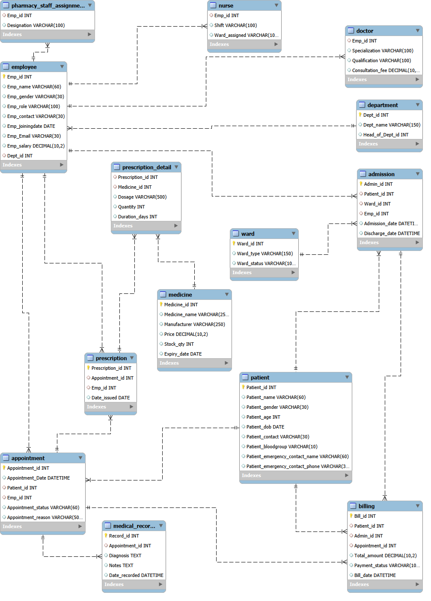

# Hospital Management Database

A relational database for managing hospital staff, patients, appointments, prescriptions, admissions, and billing.

## Database tables

- **People:** Employee, Doctor, Nurse, Pharmacy_staff_assignment, Patient, Department
- **Visits:** Appointment, Medical_records
- **Pharmacy:** Medicine, Prescription, Prescription_detail
- **Admissions and billing:** Ward, Admission, Billing

## Sample data

| Table | Rows |
|---|---|
| Department | 4 |
| Employee | 8 |
| Patient | 5 |
| Appointment | 5 |
| Medicine | 5 |
| Prescription | 3 |
| Admission | 2 |
| Billing | 5 |

## Tech used

- MySQL 8.0
- MySQL Workbench

## How to run it

1. Create and select the database:
   `CREATE DATABASE hospital;`
   `USE hospital;`
2. Run `01_create_tables.sql`
3. Run `02_sample_data.sql`

## EER diagram

